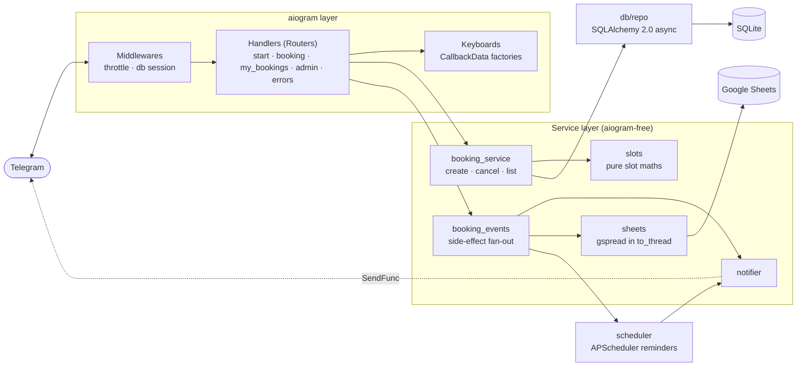
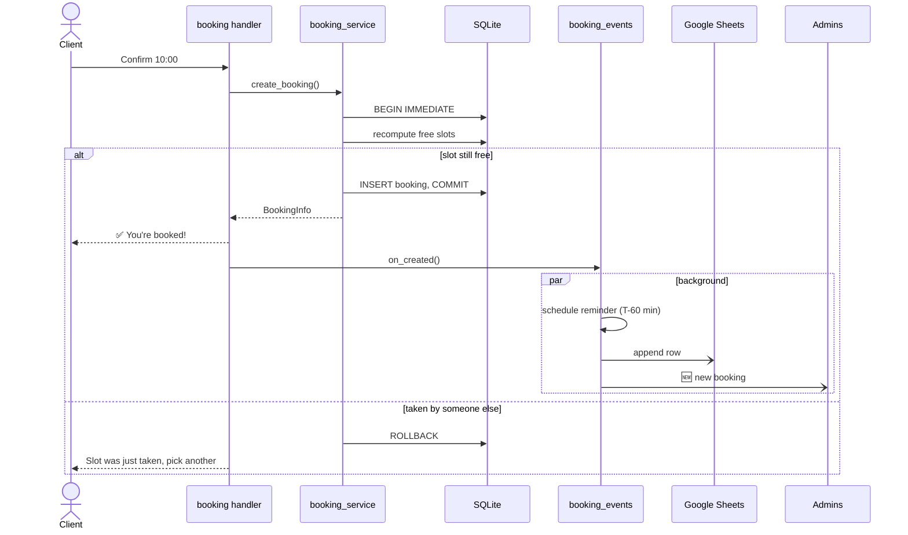

<div align="center">

# 💈 Booking Bot

**Telegram bot for booking appointments at salons, barbershops and studios.**

Clients pick a service, a date and a free time slot in a few taps. Admins see the
schedule, every booking is mirrored to Google Sheets, and clients get a reminder
one hour before their visit.


</div>

---

## ✨ Features

**For clients**
- 📅 **Step-by-step booking**: service → date (next 14 days) → free time → confirmation
- 🚫 **Only free slots are shown.** Busy, past and too-short gaps are hidden automatically
- 📋 **My bookings**: list of upcoming visits with one-tap cancellation
- ⏰ **Reminder 1 hour before the visit.** Reminders survive bot restarts

**For admins**
- 🛠 **`/admin` panel**: bookings for today and tomorrow with daily revenue
- ❌ **Cancel any booking**: the client is notified automatically
- 🔔 **Instant notifications** about new and cancelled bookings
- 📊 **Google Sheets mirror**: every booking is a row, status is kept in sync

**Under the hood**
- 🔒 **No double bookings.** The availability check and insert run in one `BEGIN IMMEDIATE` transaction
- 🌍 **Time zone aware.** UTC in the DB, local business hours in config, DST-safe
- 🛡 **Resilient.** If Google Sheets is down the booking still succeeds; a global error handler keeps the bot alive
- 🐢 **Anti-spam** throttling middleware for button mashing
- ✅ **Tested.** 38 pytest tests: slot maths, time zones, race conditions, cancellations, reminders

---

## 🚀 Quick start

Requires **Python 3.11+** and a bot token from [@BotFather](https://t.me/BotFather).

```bash
git clone https://github.com/<your-username>/booking_bot.git && cd booking_bot
python -m venv .venv && source .venv/bin/activate      # Windows: .venv\Scripts\activate
pip install -r requirements.txt
cp .env.example .env                                    # then set BOT_TOKEN and ADMIN_IDS
python main.py
```

Open your bot in Telegram and send `/start`. Three demo services are created on first run.

---

## ⚙️ Configuration

All settings live in `.env` (see [`.env.example`](.env.example)). Secrets are never committed.

```env
# Telegram
BOT_TOKEN=123456:ABC-your-token-here
ADMIN_IDS=111111111,222222222          # your id: @userinfobot

# Database
DATABASE_URL=sqlite+aiosqlite:///booking.db

# Schedule (local business time)
TIMEZONE=Europe/Moscow
WORK_START=10:00
WORK_END=20:00
SLOT_STEP_MIN=30
BOOKING_DAYS_AHEAD=14
REMINDER_BEFORE_MIN=60

# Google Sheets (optional, leave empty to disable)
GOOGLE_CREDENTIALS_FILE=service_account.json
GOOGLE_SPREADSHEET_ID=
GOOGLE_WORKSHEET=Bookings

# Misc
THROTTLE_RATE_SEC=0.5
LOG_LEVEL=INFO
```

<details>
<summary><b>📊 Google Sheets setup (5 minutes)</b></summary>

1. Open [Google Cloud Console](https://console.cloud.google.com/) and create a project (or pick an existing one).
2. **APIs & Services → Library**: enable **Google Sheets API** and **Google Drive API**.
3. **APIs & Services → Credentials → Create credentials → Service account**. Give it any name and skip the optional steps.
4. Open the service account → **Keys → Add key → Create new key → JSON**. Save the file as `service_account.json` in the project root (it is git-ignored).
5. Create a Google Sheet. Click **Share** and add the service account e-mail
   (`…@…iam.gserviceaccount.com`, also in the JSON as `client_email`) with **Editor** access.
6. Copy the spreadsheet ID from its URL, `https://docs.google.com/spreadsheets/d/<SPREADSHEET_ID>/edit`,
   into `GOOGLE_SPREADSHEET_ID`.

On startup the bot connects to the sheet, creates the `Bookings` worksheet with a header row if needed, and logs `Google Sheets connected`.
If anything is misconfigured, the error is logged and the bot keeps working without the sheet.

</details>

---

## 🏗 Architecture

The bot follows a layered design: **handlers stay thin**, business logic lives in
**services that don't know about aiogram**, and **all SQL is in one repository module**.



### Booking flow



### Key design decisions

| Decision | Why |
|---|---|
| **UTC in DB, local time only for display** | A custom `UTCDateTime` type makes SQLite store naive UTC and return aware datetimes. Slot maths happens in the business time zone, so DST switches don't shift working hours. |
| **`BEGIN IMMEDIATE` for booking** | SQLite takes the write lock *before* the availability check, so concurrent clients are serialised. A test runs 5 parallel clients on one slot: exactly one wins. |
| **Pure `slots.py`** | No DB, no I/O, deterministic `now` argument. Edge cases are unit-tested in milliseconds. |
| **DTOs (`BookingInfo`) instead of ORM objects** | Handlers never trigger lazy loads (which fail in async SQLAlchemy) and stay decoupled from the schema. |
| **Side effects after commit, in background** | The DB is the source of truth. Sheets and notifications run as background tasks, and a failure there never loses a booking. |
| **Reminders rebuilt from DB on startup** | The APScheduler job store is in memory. On restart `restore()` re-plans every pending reminder using the `reminder_sent` flag. Claiming a reminder is an atomic `UPDATE … WHERE reminder_sent = false`, so it is never sent twice. |
| **Notifier depends on a `SendFunc`, not on aiogram** | Services stay framework-agnostic and are easy to test with a fake sender. |

### Project structure

```
booking_bot/
├── main.py                  # wiring & polling
├── config.py                # pydantic-settings
├── scheduler.py             # APScheduler reminders
├── handlers/                # routers: start, booking (FSM), my_bookings, admin, errors
├── keyboards/               # inline keyboards + CallbackData factories
├── states/                  # FSM states
├── services/
│   ├── slots.py             # pure slot calculation
│   ├── booking_service.py   # business logic
│   ├── booking_events.py    # post-commit side effects
│   ├── notifier.py          # message texts & delivery
│   └── sheets.py            # Google Sheets mirror
├── db/                      # models, session, repository
├── middlewares/             # db session, throttling
├── filters/                 # AdminFilter
├── utils/                   # formatting, Telegram sender
└── tests/                   # pytest
```

---

## 🧪 Tests

```bash
pytest -q
```

| Suite | Covers |
|---|---|
| `test_slots.py` | Interval overlaps and boundaries, working-day edges, past slots, UTC ↔ local conversion, DST switch |
| `test_booking_service.py` | 5 concurrent clients on one slot, cancellation and ownership, reminders sent once, last-minute bookings, auto-completion |
| `test_sheets_and_notifier.py` | Sheets failures don't crash, rows are written RAW (no formula injection), HTML escaping in notifications |

---

## 🗺 Roadmap

- [ ] Docker & docker-compose
- [ ] Webhook mode
- [ ] Redis FSM storage (survive restarts mid-dialog)
- [ ] Alembic migrations
- [ ] Multiple masters / staff schedules
- [ ] Phone number collection via contact sharing

---

<div align="center">

Built with ❤️ using **aiogram 3**, **SQLAlchemy 2.0** and **APScheduler**

</div>
